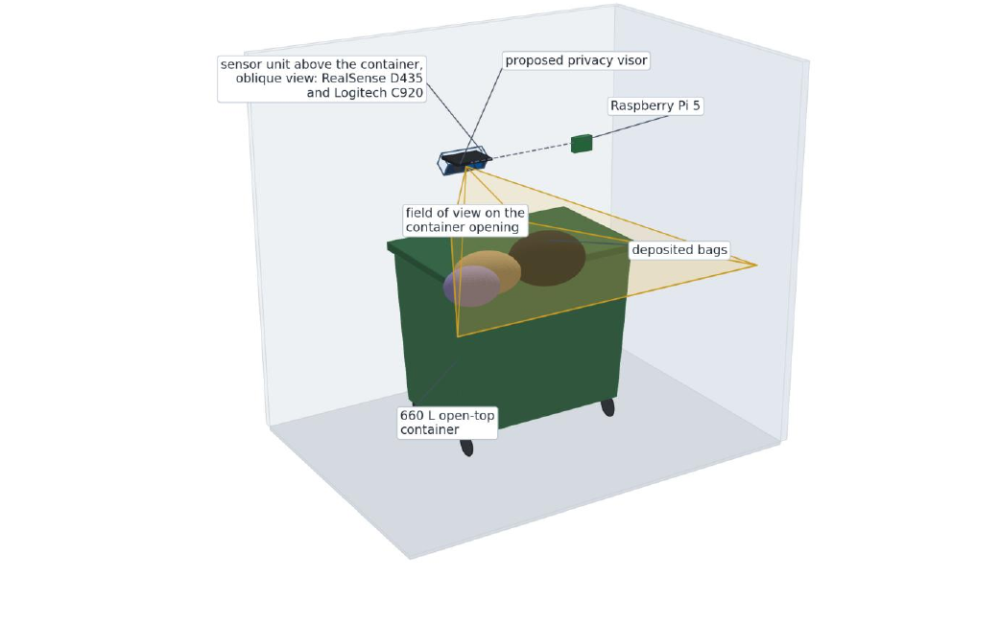
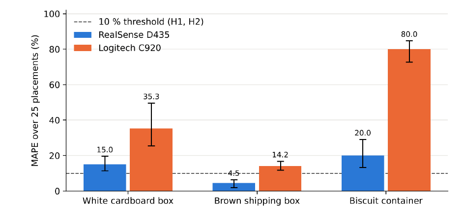
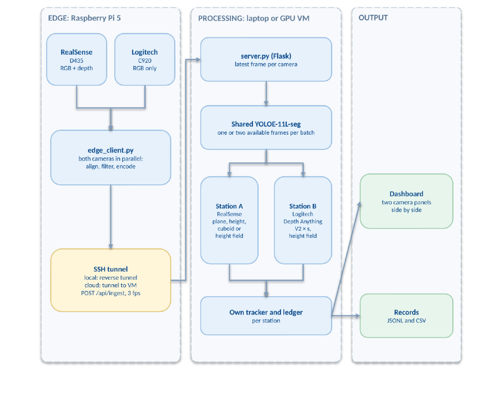
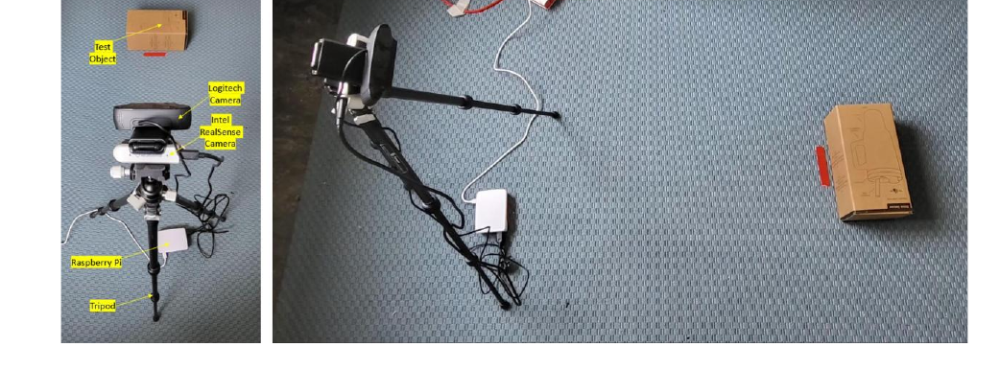
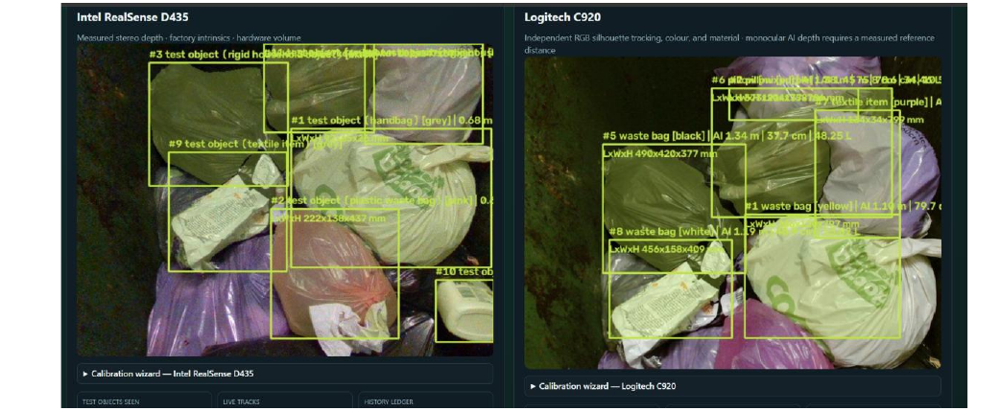

# Waste Volume Estimation with RGB and Depth Cameras

**MSc thesis · KTH Royal Institute of Technology × Local Life AB · Stockholm, 2026**

Can a camera above a shared recycling bin tell how much waste each person drops in, and can a cheap webcam with an AI depth model replace a dedicated depth camera? I designed, built and tested a dual-camera prototype to find out.

## Key results

| | Intel RealSense D435 (depth camera) | Logitech C920 + Depth Anything V2 (webcam + AI depth) |
|---|---|---|
| Volume error (MAPE, 3 rigid objects, 75 placements) | **13.2 %** (95 % CI 4.8–21.0 %) | 43.2 % (95 % CI 14.6–79.3 %) |
| Readings within ±10 % | **41 / 75** | 5 / 75 |
| Repeatability at a fixed pose (SD) | 0.03–0.05 L | 0.04–0.09 L |
| Bags counted in a real 660 L bin | 5 / 5 | 5 / 5 |

- **Recommendation to Local Life AB:** use the depth camera for volume; the webcam branch overestimated every object.
- **Local vs cloud:** a Google Cloud NVIDIA L4 GPU gave lower latency and higher throughput than a laptop CPU but started about 50 s slower; running it all day would cost about 5,300 SEK per month, so cloud should run only when needed.

## How it works

1. **Edge:** a Raspberry Pi 5 reads both cameras and streams frames over an SSH tunnel.
2. **Detection:** YOLOE-11L segmentation finds new objects in the bin.
3. **Depth:** the RealSense measures depth directly; for the webcam, Depth Anything V2 predicts depth, scaled by a measured distance to the floor.
4. **Volume:** a floor plane is fitted, and the height of every pixel above it is multiplied by the area that pixel covers, then summed.
5. **Tracking & ledger:** each deposit is tracked, logged (JSONL/CSV) and shown on a live Flask dashboard. Processing runs locally, on a cloud GPU, or switches automatically.

## Prototype and dashboard

## Tech stack
Python · OpenCV · Ultralytics YOLOE · Hugging Face Transformers (Depth Anything V2, CLIP) · pyrealsense2 · Flask · Raspberry Pi 5 · Intel RealSense D435 · Google Cloud (NVIDIA L4) · 1,387 automated tests

## About the code
The prototype software was written during the degree project at Local Life AB, which owns the code, so it is not published here. This repository documents the system, method and results. The full thesis is available as a [PDF](VaibhavJain_MSc_Thesis_Waste_Volume_Estimation.pdf).

## Author
**Vaibhav Jain** · [vbhvjain.netlify.app](https://vbhvjain.netlify.app) · [LinkedIn](https://linkedin.com/in/vbhvjain)
Supervisor: Hossein Shahrokni · Examiner: Olga Kordas (KTH) · Company contact: Thilini Gamage (Local Life AB)
